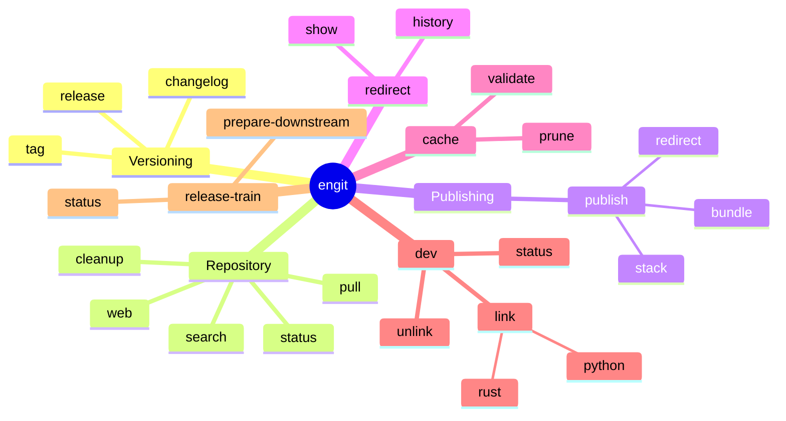

# engit CLI Reference

`engit` is the developer toolchain for envoy bundles — versioning, releasing, publishing, and repository management.

## Subcommands



## `engit tag`

Create an annotated semantic version git tag at HEAD.

```
engit tag (--major | --minor | --patch | --version VERSION) [OPTIONS]
```

| Flag | Description |
|---|---|
| `--major` | Increment major version, reset minor and patch to 0 |
| `--minor` | Increment minor version, reset patch to 0 |
| `--patch` | Increment patch version |
| `--version VERSION` | Explicit version (e.g. `v1.2.3`, `1.2.3-alpha`) |
| `--message`, `-m` | Supply tag annotation directly, skipping the editor |
| `--print`, `-p` | Print the computed next version without creating a tag |
| `--dry-run` | Print the planned tag without creating it |

**Examples:**

```powershell
engit tag --patch               # v1.0.1 (increments current latest)
engit tag --minor               # v1.1.0
engit tag --version 2.0.0       # explicit version
engit tag --version 1.2.3-alpha # pre-release (auto-sequences: v1.2.3-alpha.1)
engit tag --patch --dry-run     # preview without tagging
```

!!! note "Pre-release sequencing"
    When using `--version` with a pre-release suffix (e.g. `1.2.3-alpha`), omitting the sequence number auto-detects the next one. `v1.2.3-alpha.3` becomes `v1.2.3-alpha.4` if `.1`–`.3` already exist.

## `engit release`

Create a GitHub release from an existing tag.

```
engit release [OPTIONS]
```

| Flag | Description |
|---|---|
| `--tag TAG` | Tag to release. Defaults to the most recent semver tag |
| `--title TITLE` | Release title. Defaults to the tag string |
| `--draft` | Create as a draft release |
| `--remote REMOTE` | Remote to push to (default: `origin`) |
| `--generate-notes` | Append GitHub auto-generated "What's Changed" notes |
| `--print`, `-p` | Print resolved release notes without publishing |
| `--dry-run` | Print the planned release without creating it |

**Examples:**

```powershell
engit release                          # release latest tag
engit release --tag v1.2.3             # release specific tag
engit release --draft                  # create as draft first
engit release --generate-notes         # append GitHub PR summary
```

## `engit publish`

Publish runtime artifacts to their canonical studio locations.

### `engit publish bundle`

Create an immutable, versioned runtime bundle.

```text
engit publish bundle [PATH] [OPTIONS]
```

| Flag | Description |
|---|---|
| `PATH` | Bundle root or bundle ID. Defaults to the current directory |
| `--output`, `-o DIR` | Publish root. Defaults to `ENVOY_BUNDLE_PUBLISH_ROOT` |
| `--version VERSION` | Version. Defaults to the latest semver tag; use `dev` for development |
| `--include GLOB` | Add a root-relative runtime include; repeatable |
| `--exclude GLOB` | Add a root-relative exclusion; repeatable and takes precedence |
| `--zip` | Also create a zip containing the same runtime dataset |
| `--force` | Replace an existing `dev` publish; invalid for released versions |
| `--dry-run` | Validate and list files and destinations without writing |

Without `--output`, Engit uses `ENVOY_BUNDLE_PUBLISH_ROOT`.

The published `.bundle` marker records the bundle ID as `<namespace>:<name>`. A
bundle named without a namespace (a repository called `globals`) is recorded in
Envoy's default namespace as `gt:globals`; it is still published to
`<root>/globals/<version>`.

The default runtime allowlist is:

- Directories: `.envoy`, `py`, `bin`, `prebuilt`, `resources`, `resource`, and `docs`
- Legal files: `LICENSE*`, `NOTICE*`, and `THIRD_PARTY_LICENSES*`

VCS metadata, build output, Cargo targets, tool caches, `__pycache__`, `*.pyc`,
and `*.pyo` are always excluded. Runtime extensions such as `.pyd`, `.dll`, and `.so`
remain eligible.

Released versions are immutable. Replacing an existing development publish requires
`--version dev --force`.

#### Publish manifest

Optional bundle policy lives at `.envoy/publish-manifest.yaml`:

```yaml
include:
  - custom-runtime/**

exclude:
  - docs/internal/**

artifacts:
  - source: ${ENVOY_STUDIO_ARTIFACTS}/ext/python/${BASE_VERSION}
    destination: .
    include:
      - custom/**
    exclude:
      - temporary/**
```

The manifest is strict: unknown keys, invalid globs, unresolved variables, missing
artifact sources, unsafe destinations, and destination collisions are errors. Defaults
apply to the bundle and each external source. Manifest rules customize their source,
CLI rules apply globally, and exclusions always win. `${VERSION}`,
`${BASE_VERSION}`, and environment variables are supported in artifact sources.

The retired `.envoy/bundle-artifacts.json` file is rejected with a migration error.

#### Examples

```powershell
# Publish to ENVOY_BUNDLE_PUBLISH_ROOT using the latest semver tag
engit publish bundle

# Publish a development build locally and also create a zip
engit publish bundle --output dist --version dev --zip

# Replace a prior development publish
engit publish bundle --output dist --version dev --force

# Preview an additional runtime path
engit publish bundle --include config/** --dry-run
```

### `engit publish stack`

Publish a validated `.estack` file to an immutable, timestamped named slot.
The stack name is derived from the source filename, and the source's
immediate parent directory must use the same name.

```text
<root>/<name>/<timestamp>/<name>.estack
```

```text
engit publish stack SOURCE [OPTIONS]
```

| Argument/Flag | Description |
|---|---|
| `SOURCE` | Strict YAML `.estack` file |
| `--output`, `-o DIR` | Stack publish root. Defaults to `ENVOY_STACK_PUBLISH_ROOT` |
| `--dry-run` | Validate and show planned writes without publishing |

```powershell
engit publish stack V:/repo/gtvfx-envoy/stacks/studio/studio.estack
engit publish stack V:/repo/gtvfx-envoy/stacks/studio/studio.estack --output R:/studio/envoy/stack
engit publish stack V:/repo/gtvfx-envoy/stacks/studio/studio.estack --dry-run
```

### `engit publish redirect`

Publish the redirect file: the file that pins an Envoy version for each user,
which the launcher reads from the config root before it starts Envoy. A bad
file stops everyone it covers from starting Envoy, so the file is checked first
and nothing is written when a check fails.

```text
engit publish redirect FILE [OPTIONS]
```

| Argument/Flag | Description |
|---|---|
| `FILE` | The redirect file to publish |
| `--output`, `-o DIR` | Config root to publish into. Defaults to `ENVOY_CONFIG_PUBLISH_ROOT` |
| `--team TEAM` | Publish for one team: the file goes into `<root>/<team>/` |
| `--platform PLATFORM` | A system whose launchers must find each pinned version: `windows` (`bin/envoy.exe`), `linux` or `macos` (`bin/envoy`), or `all`. Repeat it to name several. Defaults to the system `engit` runs on |
| `--no-check-sources` | Do not check that every pinned version is on a source |
| `--dry-run` | Check everything and show what would be written, without writing |

In order, it:

1. Parses and validates the file with the launcher's own code, so everything
   the launcher's `--envoy-shim-validate-config` reports is an error here too:
   no `default` version, a user in a group with no version, an unsafe version
   name, a user listed twice, an unknown key, or a schema newer than this
   `engit` understands (update `engit`).
2. Looks for every version the file pins on its `sources`, the way the launcher
   does: the first source whose folder has the executable as a file. A version
   no source has stops the publish, because every user pinned to it would fail
   to start. `--no-check-sources` skips this, for example when the sources
   cannot be reached from where you publish.
3. Stops with `Nothing to publish` when the live file already has exactly this
   content.
4. Waits for its turn to publish into the folder (see
   [Two people publishing](#two-people-publishing)), then keeps the file that
   is live now in the history when the history does not have it, keeps a copy
   of the new file, and replaces the live file in one step, so a launcher that
   reads it sees the old file or the new one, never half of either.

#### Which executable counts

The launcher on each system looks for its own executable in a version's folder:
`bin/envoy.exe` on Windows, `bin/envoy` on Linux and macOS. A version folder
that has only one of them is a version for only the systems that use it, and
every user of another system pinned to it would fail to start.

By default `engit` holds each version to the executable of the system it runs
on, which is exactly what the launcher's own `--envoy-shim-validate-config
--check-sources` reports on the same machine. If the studio has other systems,
name them:

```powershell
engit publish redirect redirect.yaml --platform all
engit publish redirect redirect.yaml --platform windows --platform linux
```

A version folder that serves every system holds both executables, which you get
by unpacking the release archive of each system into it.

#### The config root

```text
<root>/redirect.yaml                                    everyone
<root>/<team>/redirect.yaml                             one team (--team)
<root>/history/redirect-<UTC timestamp>-<user>.yaml     every file that went live
<root>/.redirect.lock                                   publishers take turns on it
```

A team's history is `<root>/<team>/history/`, and a team's folder has its own
lock file. Leave `.redirect.lock` in place: it is empty and is how two people
publishing at once take turns.

A history copy has exactly the content of the live file it came from, and its
name says when and by whom (the user name is the launcher's own form: lower
case, without the domain). Every file that went live is in the history, so to
put an earlier one back, publish it again.

- A file that was put there by hand, before `engit` first published, is kept
  too, the first time it is replaced. Nobody knows who published it, so it is
  named for the time it was last changed and for `unknown`:
  `redirect-2026-10-30-094512-unknown.yaml`.
- A publish that is cut off between keeping the copy and replacing the live
  file can leave a copy of a file that never went live. `redirect history`
  marks the one that is live.

Without `--output`, Engit uses `ENVOY_CONFIG_PUBLISH_ROOT`. It never uses
`ENVOY_CONFIG_PROD`, the variable the launcher reads, so a machine that only
consumes the file cannot publish by accident.

The config root must already exist. `engit` does not create it, so a mistyped
`--output` is an error rather than a new folder that no launcher reads. A
team's folder is created by the team's first publish, and a team name may use
letters, digits, `.`, `_` and `-`, and may not end with a `.`, which Windows
drops from a folder name.

#### Two people publishing

Publishing into a folder is one person at a time. A second publish waits for
the first for up to ten seconds, then stops with an error and changes nothing.
The turn is an operating system lock on `.redirect.lock`, so it is let go when
the program ends, however it ends: there is never a stale lock to clear.

A location that cannot lock files (some network mounts) cannot make anyone wait,
and `engit` says so in a note under the result. Publishing still works there.

A history name is created as a new file and never replaces one, so two people
publishing as the same user in the same second cannot lose an entry: the second
gets an error and tries again.

#### Permissions on Linux and macOS

The launcher of every user must read the file, so the live file and each history
copy are made readable by everyone (mode `644`) whatever the publisher's umask
is. A folder `engit` creates, such as a team's, is given the same permissions as
the folder it is in, so that another administrator can publish into it.

```text
Published the redirect file.
  Live:     R:\studio\envoy\config\redirect.yaml
  History:  R:\studio\envoy\config\history\redirect-2026-11-02-171100-alice.yaml
  Versions:
    default  v0.8.0  (found at R:\studio\envoy\bndl\envoy\v0.8.0)
    preview  v0.8.1-rc.1  (found at R:\studio\envoy\bndl\envoy\v0.8.1-rc.1)
```

The first publish over a file that was put there by hand also says what it kept:

```text
Published the redirect file.
  Live:     R:\studio\envoy\config\redirect.yaml
  History:  R:\studio\envoy\config\history\redirect-2026-11-02-171100-alice.yaml
  Kept:     R:\studio\envoy\config\history\redirect-2026-10-30-094512-unknown.yaml (the file that was live, which the history did not have)
  Versions:
    default  v0.8.0  (found at R:\studio\envoy\bndl\envoy\v0.8.0)
```

A file that pins a version no source has is refused, and nothing is written:

```text
Error: 1 pinned version(s) cannot be found on any source, so the file was not published:
  group 'default' is pinned to v0.9.9, which was not found. Looked in:
    R:\studio\envoy\bndl\envoy\v0.9.9: there is no bin/envoy.exe there
Fix the file or the sources, or publish anyway with --no-check-sources.
```

```powershell
engit publish redirect redirect.yaml --dry-run
engit publish redirect redirect.yaml --output R:/studio/envoy/config
engit publish redirect redirect.yaml --platform all
engit publish redirect rigging.yaml --team rigging
engit publish redirect R:/studio/envoy/config/history/redirect-2026-11-02-171000-alice.yaml
```

## `engit redirect`

Look at the redirect file that is published.

### `engit redirect show`

```text
engit redirect show [--root DIR] [--team TEAM] [--user USER] [--platform PLATFORM]
```

| Flag | Description |
|---|---|
| `--root DIR` | Config root to read. Defaults to `ENVOY_CONFIG_PUBLISH_ROOT`, then `ENVOY_CONFIG_PROD` |
| `--team TEAM` | Show a team's file instead of everyone's |
| `--user USER` | Also say which version this user gets |
| `--platform PLATFORM` | The systems whose launchers must find each version, as for `publish redirect` |

It prints the sources, the version each group is pinned to and whether a source
has it, and the users the file lists with the group the launcher gives each. A
version no source has is shown, with where it was looked for and why it was not
found, rather than refused: this is for looking at what is already published.

```text
Redirect file: R:\studio\envoy\config\redirect.yaml
  Schema:   1
  Sources:
    ${ENVOY_STUDIO_BNDLS}/envoy/{version}
  Versions:
    default  v0.8.0  (found at R:\studio\envoy\bndl\envoy\v0.8.0)
    preview  v0.9.0  (NOT FOUND on any source)
        R:\studio\envoy\bndl\envoy\v0.9.0: there is no bin/envoy.exe there
  Users:
    alice  preview
  alice: group 'preview' (listed) -> v0.9.0
```

A root or a team that does not exist is an error, as is a root with no redirect
file in it.

### `engit redirect history`

```text
engit redirect history [--root DIR] [--team TEAM]
```

Lists every file that was published, newest first. `(live)` marks the newest
copy of the file the launcher reads now.

```text
2026-11-02-171100  alice     412 bytes  (live)  R:\studio\envoy\config\history\redirect-2026-11-02-171100-alice.yaml
2026-11-02-171000  alice     398 bytes          R:\studio\envoy\config\history\redirect-2026-11-02-171000-alice.yaml
2026-10-30-094512  unknown   361 bytes          R:\studio\envoy\config\history\redirect-2026-10-30-094512-unknown.yaml
```

A root or a team that does not exist is an error. A root where nothing has been
published says so and is not an error.

## `engit status`

Show repository status — branch, ahead/behind remote, last semver tag, and most recent commit.

```
engit status [--remote REMOTE]
```

## `engit changelog`

Generate a formatted changelog from published GitHub releases, sorted by semantic version.

```
engit changelog [--tag TAG]
```

| Flag | Description |
|---|---|
| `--tag TAG` | Show only the release for this tag |

## `engit cleanup`

Prune stale remote-tracking refs, delete merged branches, and delete branches whose remote has been deleted.

```
engit cleanup [--remote REMOTE] [--noop]
```

| Flag | Description |
|---|---|
| `--remote REMOTE` | Remote to prune (default: `origin`) |
| `--noop` | Print what would be deleted without deleting anything |

## `engit web`

Open the repository on GitHub in the default browser.

```
engit web [--branch BRANCH] [--remote REMOTE]
```

## `engit pull`

Pull one or more envoy bundle checkouts by bundle ID.

```
engit pull BUNDLE [BUNDLE ...] [--remote REMOTE] [--rebase] [--dry-run]
```

| Argument/Flag | Description |
|---|---|
| `BUNDLE` | Bundle ID (e.g. `gt:globals`), or `*` to pull all bundles from `ENVOY_BNDL_ROOTS` |
| `--remote REMOTE` | Remote to pull from (default: `origin`) |
| `--rebase` | Pass `--rebase` to `git pull` |
| `--dry-run` | Print what would be pulled without running git |

**Examples:**

```powershell
engit pull gt:globals
engit pull gt:globals gt:pythoncore
engit pull *                    # pull all discovered bundles
engit pull * --dry-run
```

## `engit search`

Search GitHub repositories matching a query, scoped to configured organisations.

```
engit search QUERY [--org ORG] [--limit N]
```

| Flag | Description |
|---|---|
| `--org ORG` | GitHub organisation to search. May be repeated. Overrides the default organisations from `ENVOY_GITHUB_ORGS` |
| `--limit N` | Maximum results per organisation (default: 20) |

The default organisations are read from the `ENGIT_ORGS` environment variable (semicolon-separated).

## `engit cache`

Inspect or clean up the local bundle cache that envoy populates automatically
during stack resolution.

### `engit cache validate`

Recompute each cached bundle's content hash and check for a metadata
sidecar, a missing storage directory, or content-hash directories with no
referencing cache entry (orphans left behind by interrupted writes).

```
engit cache validate [--cache-dir DIR]
```

| Flag | Description |
|---|---|
| `--cache-dir DIR` | Cache directory to validate. Defaults to the resolved default bundle cache (`ENVOY_BUNDLE_CACHE`, user config, or platform default) |

Exits non-zero if any problems are found.

### `engit cache prune`

Remove cached entries matching a selector, or -- with no selector --
immediately apply envoy's own age/size retention policy instead of waiting
for it to trigger on the next cache write.

```
engit cache prune [--cache-dir DIR] [--id BUNDLE_ID]... [--pattern GLOB] [--older-than DAYS] [--remove-orphans] [--dry-run]
```

| Flag | Description |
|---|---|
| `--cache-dir DIR` | Cache directory to prune. Defaults to the resolved default bundle cache |
| `--id BUNDLE_ID` | Restrict to entries with this exact bundle ID. May be repeated |
| `--pattern GLOB` | Restrict to entries whose bundle ID matches this glob pattern |
| `--older-than DAYS` | Restrict to entries created more than this many days ago |
| `--remove-orphans` | Also remove content-hash storage directories no longer referenced by the cache index |
| `--dry-run` | Print what would be removed without deleting anything. Not supported with no selector (the default retention policy has no preview mode) |

Selectors combine with AND semantics: `--id gt:globals --older-than 30`
prunes only cached entries for `gt:globals` older than 30 days, not every
entry matching either condition.

**Examples:**

```powershell
engit cache validate
engit cache prune --id gt:globals --dry-run
engit cache prune --pattern "gt:*" --older-than 60
engit cache prune --remove-orphans
engit cache prune                    # apply default retention policy now
```

## `engit dev`

Local cross-repo development helpers. Point this workspace's `envoy-core`
Cargo dependency, or a freshly built Envoy Python wheel, at an in-progress
local Envoy checkout instead of a published release -- reversibly, and
without a by-hand `Cargo.toml` edit. All state lives under the
already-gitignored `rust/target/engit-dev/`, so a link can never be
accidentally committed (`lint.yml` also fails fast if one is).

### `engit dev link rust`

Swap the `envoy-core` Cargo dependency to a local Envoy checkout, saving the
original pin so it can be restored exactly.

```
engit dev link rust [ENVOY]
```

| Argument | Description |
|---|---|
| `ENVOY` | Local Envoy checkout path or bundle ID (e.g. `gt:envoy`). Defaults to `gt:envoy`, resolved via `ENVOY_BNDL_ROOTS` |

Runs `cargo check --workspace` after swapping to confirm it resolves.
Re-running `engit dev link rust` with a different checkout re-points the
dependency without losing the originally saved pin.

### `engit dev link python`

Build a local Envoy Python wheel via `maturin` and install it into an
isolated, self-contained dev bundle (a generated `.envoy/python_env.json`
pointing `PYTHONPATH` at the installed wheel). No shared or global
site-packages are ever touched.

```
engit dev link python [ENVOY] [--release]
```

| Argument/Flag | Description |
|---|---|
| `ENVOY` | Local Envoy checkout path or bundle ID. Defaults to `gt:envoy` |
| `--release` | Build Envoy's Python wheel in release mode |

The interpreter is resolved via `envoy --which python`, matching whatever
Stack is currently active. If you have an Envoy Stack active, add the
printed bundle path directly to it -- Envoy resolves bundles from the
active Stack and does not consult `ENVOY_BNDL_ROOTS` while one is set.
Otherwise, add its parent directory to `ENVOY_BNDL_ROOTS` (or reference it
directly) to make it available via no-Stack auto-discovery.

### `engit dev unlink`

Reverse a prior `engit dev link`.

```
engit dev unlink rust
engit dev unlink python
```

`unlink rust` restores the exact previously pinned `envoy-core` dependency
and reruns `cargo check --workspace`. `unlink python` removes the generated
dev bundle. Both are safe no-ops when nothing is currently linked.

### `engit dev status`

Show whether Rust and/or Python are currently dev-linked, and to what path.

```
engit dev status
```

**Examples:**

```powershell
engit dev link rust ..\envoy
engit dev status
engit dev unlink rust

engit dev link python ..\envoy --release
engit dev unlink python
```

## `engit release-train`

Cross-repo release-train orchestration across Envoy and its downstream
repositories (`envoy_utils`, `despatch`). See the
[releasing guide](https://gtvfx-envoy.github.io/envoy/maintainers/releasing/)
for the full release-train process this complements.

### `engit release-train status`

Print each repository's latest published release and any open, tracked
release-impact issue -- a single-pane view of the release-train checklist.

```
engit release-train status [--owner ORG] [--repo REPO]...
```

| Flag | Description |
|---|---|
| `--owner ORG` | GitHub organisation owning the release-train repositories (default: `gtvfx-envoy`) |
| `--repo REPO` | Repository to report on (`envoy`, `envoy_utils`, or `despatch`). May be repeated. Defaults to all three |

### `engit release-train prepare-downstream`

Compute the next version for a downstream repository and dispatch its
existing, unmodified `prepare-release.yml` workflow with that version and
the given Envoy pin. This never bypasses or auto-merges that workflow's own
validation and draft pull request -- it only ever triggers it.

```
engit release-train prepare-downstream --repo REPO --envoy-version VERSION [OPTIONS]
```

| Flag | Description |
|---|---|
| `--repo REPO` | Downstream repository to prepare (`envoy_utils` or `despatch`) |
| `--envoy-version VERSION` | Published, unprefixed Envoy semantic version to pin (e.g. `0.6.0`) |
| `--major` / `--minor` / `--patch` | Bump component of the latest release. Defaults to `--patch` when no bump or `--version` is given |
| `--version VERSION` | Explicit next downstream version, instead of bumping the latest release |
| `--owner ORG` | GitHub organisation (default: `gtvfx-envoy`) |
| `--dry-run` | Print the `gh` invocation without dispatching anything |

**Examples:**

```powershell
engit release-train status
engit release-train prepare-downstream --repo despatch --envoy-version 0.6.0 --dry-run
engit release-train prepare-downstream --repo envoy_utils --envoy-version 0.6.0
```
